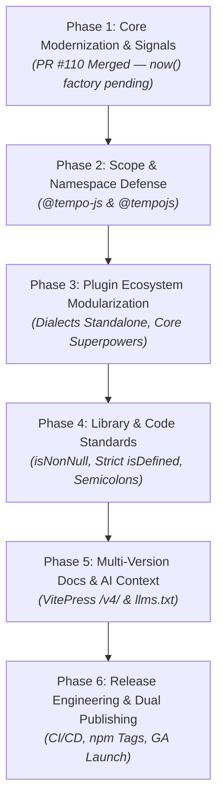

# Tempo v5.0.0 Master Plan & Phase Roadmap

## 1. Executive Summary & Vision

Tempo **v5.0.0** represents the definitive modern milestone for the Tempo date-time engine. Unlike minor releases (`v4.x`), v5 establishes a clean break from legacy and suboptimal API conventions, establishes a dedicated, developer-friendly npm namespace (**`@tempo-js`** with defensive perimeter coverage for **`@tempojs`**), optimizes the core bundle size for greenfield and serverless/edge environments, and introduces reactive signals.

This Master Plan consolidates all prior RFCs, breaking change analyses, and architectural proposals into a unified, phase-based execution checklist.

---

## 2. Phase-Based Execution Roadmap



---

### Phase 1: Core Modernization, Deprecations & Signals (PR #110 & Phase 1 Complete)
*Status: Nearly Completed — `Tempo.now()` instance factory and `Tempo.epoch` fully transitioned and tested*

- [x] **`Tempo.now()` Transition to Instance Factory**:
  - `Tempo.now()` returns an immutable `Tempo` instance (supports options like `{ timeZone, sphere }`) instead of primitive `bigint` nanoseconds.
  - Raw epoch numbers cleanly moved to `Tempo.epoch.ns`, `Tempo.epoch.ms`, `Tempo.epoch.us`, and `Tempo.epoch.ss`.
  - Static `Tempo.instant` returns native `Temporal.Instant`. Static tests updated in `static.methods.test.ts`.
- [ ] **Format Token Rationalization**:
  - Deprecate legacy `{ww}` and `{wy}` in favor of canonical ISO `{yow}` and `{woy}`.
  - Canonicalize orthogonal `:compact` modifier across parser, format, and explain, completely eliminating legacy fused modifiers (e.g. `{tz:offsetcompact}`).
  - Standardize offset sub-components on canonical `:hh`, `:mi`, `:ss`.
- [x] **Signal-Aware Ticker & NTP Architecture**:
  - Add reactive signal getters (`ticker.signal`, `Tempo.ticker.signal()`, `Tempo.ntp.signal()`).
  - Eliminate circular GC retention in `Finalizer.register` closures using `WeakRef` handles.
  - Ensure individual `toSignal()` consumer disposal only detaches that reactive subscription without stopping shared ticker instances.
- [x] **Plugin Cross-Version Compatibility**:
  - Split `getRuntime` import in `@magmacomputing/tempo-plugin-dialects` to preserve dual `^4.7.0 || ^5.0.0` peer dependency support.
- [x] **Review Remediation**:
  - Resolve all 7 CodeRabbit review findings on PR #110 with localized unit test and monorepo build verification.

---

### Phase 2: Package Scope & Namespace Defense (`@tempo-js` & `@tempojs`)
*Status: Ready to Execute*

Following the industry precedent established by Vite (`@vitejs/*`), Svelte (`@sveltejs/*`), and Discord (`@discordjs/*`), Tempo v5 will migrate from the corporate `@magmacomputing` prefix to a dedicated, community-facing JavaScript/TypeScript scope:

- [ ] **Step 1: Claim `@tempo-js` Organization on npm**:
  - Claim and initialize the **`@tempo-js`** organization on npm under organization admin.
  - Configure 2FA, team permissions, and automated GitHub Actions publishing secrets (`NPM_TOKEN`).
- [ ] **Step 2: File npm Name Dispute for `@tempojs` (Defensive Anti-Squatting)**:
  - File a formal npm Name Dispute / transfer request with npm Support for the dormant `@tempojs` scope (abandoned by the Bebop RPC project).
  - Once secured, maintain `@tempojs` defensively alongside `@tempo-js` to eliminate typosquatting and supply-chain confusion.
- [ ] **Step 3: Establish Canonical Package Mapping**:
  | Current v4 Scope (`@magmacomputing/*`) | Target v5 Scope (`@tempo-js/*`) | Role / Exports |
  | :--- | :--- | :--- |
  | `@magmacomputing/tempo` | **`@tempo-js/core`** | Fluent engine with subpath exports (`./parse`, `./format`, `./mutate`, `./duration`, `./library`, `./plugin/sdk`) |
  | `@magmacomputing/tempo-fns` | **`@tempo-js/fns`** | Standalone functional date math & algorithms |
  | `@magmacomputing/tempo-plugin-dialects` | **`@tempo-js/plugin-dialects`** | Moment / Day.js / Luxon / SQL format compatibility |
  | `@magmacomputing/tempo-plugin-ticker` | **`@tempo-js/plugin-ticker`** | High-precision reactive scheduler & pulse engine |
  | `@magmacomputing/tempo-plugin-ntp` | **`@tempo-js/plugin-ntp`** | Network Time Protocol clock drift synchronization |
  | `@magmacomputing/tempo-plugin-ai` | **`@tempo-js/plugin-ai`** | AI calendar reasoning & natural extraction |
  | `@magmacomputing/tempo-plugin-geo` | **`@tempo-js/plugin-geo`** | Reverse geocoding & timezone resolution |
  | `@magmacomputing/tempo-plugin-holidays` | **`@tempo-js/plugin-holidays`** | International public holidays & business schedules |
  | `@magmacomputing/tempo-plugin-celestial`| **`@tempo-js/plugin-celestial`** | Sun/Moon ephemeris, solar events, & tides |
  | `@magmacomputing/tempo-plugin-spatial` | **`@tempo-js/plugin-spatial`** | Geofencing, coordinate distance, bearing, velocity |
  | `@magmacomputing/tempo-plugin-sync` | **`@tempo-js/plugin-sync`** | High-precision atomic clock & drift correction |
  | `@magmacomputing/tempo-plugin-batch` | **`@tempo-js/plugin-batch`** | High-throughput batch date-time processing |
  | `@magmacomputing/tempo-plugin-roman` | **`@tempo-js/plugin-roman`** | Roman calendar & consular dating |
  | `@magmacomputing/tempo-plugin-snap` | **`@tempo-js/plugin-snap`** | Quantization & temporal snap grids |

---

### Phase 3: Plugin Ecosystem Modularization & Greenfield Optimization
*Status: Planned*

To ensure Core Tempo remains clean, modern, and unburdened by legacy runtime shims or non-essential domain data, ecosystem plugins are modularized while preserving core signature superpowers:

- [ ] **Civic vs. Cultural Terms Split (Option B)**:
  - **Civic Terms in Core**: Retain `QuarterTerm` (`#quarter`, `#qtr`) and `SeasonTerm` (`#season`) directly in Core Tempo (~2.7 KB minified, ~0.8 KB gzipped). These represent universal, uncontroversial business and calendar concepts used across reporting, fiscal cycles, and scheduling.
  - **Cultural & Domain Terms Opt-In (`@tempo-js/std`)**: Decouple `ZodiacTerm` (Western astrology), `EasternTerm` (Chinese zodiac / lunar signs), and `TimelineTerm` (geological/cosmic epochs) from Core's automatic startup loader into `@tempo-js/std` (or `@tempo-js/core/std`).
    - *Impact*: Saves **~7.4 KB minified (~2.4 KB gzipped)** from every Core Tempo bundle and completely eliminates enterprise/business skepticism around astrological horoscopes in a core date library.
    - *Consumption*: Available on-demand via `import { ZodiacTerm } from '@tempo-js/std'; Tempo.use(ZodiacTerm);` or zero-config `import '@tempo-js/std';`. Serves in documentation as the flagship showcase of Tempo's custom terminology extensibility.
- [ ] **Retain Slick Shorthand Syntax as Core Superpower**:
  - Keep intuitive term navigation (`t.set('#qtr.>q1')`, `t.add('#season.>summer')`), directional operators (`>`, `<`, `+`, `-`), and shorthand shifters (`t.set({ mm: '>2', wkd: '>Fri' })`) natively built into Core.
  - Evaluation confirmed that saving ~3–4 KB gzipped does not justify fracturing Tempo's signature ergonomics or requiring extra plugin boilerplate for fundamental shorthand.
- [ ] **Standalone Dialects Architecture (`@tempo-js/plugin-dialects`)**:
  - Keep legacy format compilers (Moment, Day.js, Luxon, POSIX `strftime`, Go, PHP, Oracle SQL) out of Core Tempo.
  - Provide 4-tier consumption:
    1. Zero-config drop-in: `import '@tempo-js/plugin-dialects';`
    2. Explicit registration: `Tempo.use(DialectsPlugin);`
    3. Granular single-dialect imports: `import '@tempo-js/plugin-dialects/luxon';`
    4. Migration AST introspection: `import { explain, convert } from '@tempo-js/plugin-dialects/migrate';`
- [ ] **Reclaim `{ww}` for Calendar Week**:
  - Free `{ww}` from being an ISO week alias; reassign it to represent calendar week of year (Jan 1 basis, matching Oracle SQL `WW`).
  - Add `{wom}` (week of month, `1`–`5`).

---

### Phase 4: Library & Code Standards Harmonization
*Status: Planned*

- [ ] **Type-Guard Semantics Correction (`isNonNull` vs. Strict `isDefined`)**:
  - *Problem*: In v4, `isDefined(null)` returned `false`, trapping `null` in a semantic void where it was neither defined nor undefined.
  - *Step 1*: Introduce `isNonNull<T>(val): val is NonNullable<T>` in `@magmacomputing/library`.
  - *Step 2*: Perform monorepo sweep migrating existing call sites from `isDefined` to `isNonNull` to ensure 100% behavioral preservation.
  - *Step 3*: Redefine `isDefined<T>(val): val is Exclude<T, undefined>` (`val !== undefined`), creating strict logical symmetry: `!isDefined(x) <=> isUndefined(x)`.
- [ ] **ECMAScript Standards Compliance: Repository-Wide Semicolon Policy**:
  - Adopt explicit statement termination across all monorepo TypeScript files (`semi: true`) per ECMA-262 § 16.2.2.
  - Add standard semicolons to VitePress theme files to eliminate one-off style anomalies.
  - Configure automated linter/formatter rule (`biome.json` / `.prettierrc`).

---

### Phase 5: Multi-Version Docs, Playground & AI Context (`llms.txt`)
*Status: Planned*

- [ ] **Archival `/v4/` Route Snapshotting in VitePress**:
  - Freeze final `v4.7.0` documentation under `/v4/` route in VitePress.
  - Deploy documentation strictly from `main` to prevent branch deployment collisions on GitHub Pages.
  - Add top-level version selector in VitePress navbar:
    ```text
    [ v5.0.0 (latest) ▼ ]
      • v5.0.0 (latest)  -> /
      • v4.7.0 (LTS)     -> /v4/
    ```
- [ ] **Version-Segregated AI Context Files (`llms.txt`)**:
  - Prevent RAG context contamination between v4 (primitive timestamps, `@magmacomputing`) and v5 (instance factories, `@tempo-js`).
  - Route layout:
    ```text
    tempo.dev/
    ├── llms.txt          <-- v5 AI Index & Quick Reference (Latest)
    ├── llms-full.txt     <-- v5 Complete Concatenated Context
    └── v4/
        ├── llms.txt      <-- v4 AI Index & Quick Reference (Frozen LTS)
        └── llms-full.txt <-- v4 Complete Concatenated Context (Frozen LTS)
    ```
  - Prominent warning banners on all `/v4/` AI bundles directing modern developers to v5.
- [ ] **Update Core Documentation**:
  - Update all code snippets in `packages/tempo/doc/` to use `@tempo-js/core`.
  - Provide comprehensive **v4 $\rightarrow$ v5 Migration Guide**.
  - **Interactive Documentation Glossary & Canonical Lexicon**: Implement data-driven VitePress glossary ([`documentation-glossary-architecture.md`](file:///home/michael/Project/magma/packages/tempo/plan/documentation-glossary-architecture.md)) defining core temporal concepts, library idioms, and standards, and pipe definitions directly into `llms.txt`.

---

### Phase 6: Release Engineering & Dual-Publishing Pipeline
*Status: Planned*

- [ ] **Automated Dual-Scope Publishing Pipeline (`publish.yml`)**:
  - Build and publish canonical packages under `@tempo-js/*`.
  - Dual-publish backward-compatibility stubs under `@magmacomputing/*` that re-export `@tempo-js/*` with deprecation notices.
- [ ] **npm Distribution Tag Architecture**:
  | Package Scope | Target Version | npm dist-tag | Target Audience |
  | :--- | :--- | :--- | :--- |
  | `@tempo-js/core` | `v5.0.0-rc.x` | `next` | Early adopters & release candidate testing |
  | `@tempo-js/core` | `v5.0.0` (GA) | `latest` | All modern greenfield and upgraded v5 installations |
  | `@magmacomputing/tempo` | `v4.7.x` | `latest-v4` (or `legacy`) | Long-term support for existing v4 codebases |
  | `@magmacomputing/tempo` | `v5.0.0` | `latest` | Dual-published bridge re-exporting `@tempo-js/core` |
- [ ] **Release Milestones**:
  - `5.0.0-alpha.x`: Internal integration.
  - `5.0.0-rc.x`: Public release candidates and ecosystem testing.
  - `5.0.0`: Official General Availability (GA).

---

## 3. Future Horizons / Exploratory Proposals (Post-v5.0 GA)

For features and architectural investigations targeted beyond the initial v5.0 General Availability release, refer to active exploratory RFCs:

* **[Signals in Core Tempo](file:///home/michael/Project/magma/packages/tempo/plan/signals-core-discussion.md)** (`signals-core-discussion.md`):
  Explores deep reactive integrations for future minor releases (v5.1+):
  1. `Tempo.live()` / `Tempo.clock()` (fine-grained continuous live clocks for UI).
  2. `tempo.relativeSignal()` (adaptive reactive relative time strings like *"3 minutes ago"* that self-adjust update frequencies).
  3. `interval.toSignal()` (reactive temporal window and progression tracking).
  4. `Tempo.locale` reactive signal (dynamic locale/theme propagation across UI signal graphs).

---

## 4. Operational Appendix: Git Squash-Merge Realignment Procedure

When long-running feature branches diverge after squash-merges onto `main`, follow this standard procedure to synchronize without false conflict churn:

1. **Ensure local `main` is up to date**:
   ```bash
   git checkout main
   git pull origin main
   ```
2. **Rebase feature branch using `--onto`**:
   Identify the base commit where the feature branch originally split from the previous feature branch, and rebase onto current `main`:
   ```bash
   git checkout feature/my-branch
   git rebase --onto main <base-commit-hash> feature/my-branch
   ```
3. **Verify and Force-Push**:
   Run local test suites to confirm clean alignment:
   ```bash
   npm test
   git push origin feature/my-branch --force-with-lease
   ```
