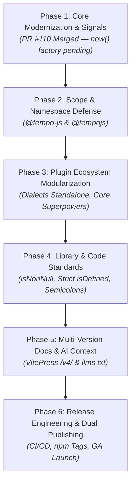

# Tempo v5.0.0 Master Plan & Phase Roadmap

## 1. Executive Summary & Vision

Tempo **v5.0.0** represents the definitive modern milestone for the Tempo date-time engine. Unlike minor releases (`v4.x`), v5 establishes a clean break from legacy and suboptimal API conventions, establishes a dedicated, developer-friendly npm namespace (**`@tempo-js`** with defensive perimeter coverage for **`@tempojs`**), optimizes the core bundle size for greenfield and serverless/edge environments, and introduces reactive signals.

This Master Plan consolidates all prior RFCs, breaking change analyses, and architectural proposals into a unified, phase-based execution checklist.

---

## 2. Phase-Based Execution Roadmap



---

### Phase 1: Core Modernization, Deprecations & Signals (PR #110 & Phase 1 Complete)
*Status: Completed*

- [x] **`Tempo.now()` Transition to Instance Factory**:
  - `Tempo.now()` returns an immutable `Tempo` instance (supports options like `{ timeZone, sphere }`) instead of primitive `bigint` nanoseconds.
  - Raw epoch numbers cleanly moved to `Tempo.epoch.ns`, `Tempo.epoch.ms`, `Tempo.epoch.us`, and `Tempo.epoch.ss`.
  - Static `Tempo.instant` returns native `Temporal.Instant`. Static tests updated in `static.methods.test.ts`.
- [x] **Format Token Rationalization**:
  - Deprecate legacy `{ww}` and `{wy}` in favor of canonical ISO `{yow}` and `{woy}`.
  - Canonicalize orthogonal `:compact` modifier across parser, format, and explain, completely eliminating legacy fused modifiers (e.g. `{tz:offsetcompact}`).
  - Standardize offset sub-components on canonical `:hh`, `:mi`, `:ss`.
- [x] **Signal-Aware Ticker & NTP Architecture**:
  - Add reactive signal getters (`ticker.signal`, `Tempo.ticker.signal()`, `Tempo.ntp.signal()`).
  - Eliminate circular GC retention in `Finalizer.register` closures using `WeakRef` handles.
  - Ensure individual `toSignal()` consumer disposal only detaches that reactive subscription without stopping shared ticker instances.
- [x] **Plugin Cross-Version Compatibility**:
  - Split `getRuntime` import in `@magmacomputing/tempo-plugin-dialects` to preserve dual `^4.7.0 || ^5.0.0` peer dependency support.
- [x] **Review Remediation**:
  - Resolve all 7 CodeRabbit review findings on PR #110 with localized unit test and monorepo build verification.
- [x] **`Tempo.derive()` Prototypal Sandbox Architecture**:
  - Transitioned legacy `Tempo.create()` to `Tempo.derive()` (Option A: clean break) aligning conceptual parity with `Enum.derive()`.
  - Non-destructive prototypal sandbox inheritance with full `[Symbol.dispose]` explicit resource management (`using`) and scoped callbacks (`Tempo.derive(fn)` / `Tempo.derive(options, fn)`).

---

### Phase 2: Package Scope & Namespace Defense (`tempo-js`, `@tempo-js` & `@tempojs`)
*Status: Ready to Execute*

Following the industry precedent established by Vite (`vite` + `@vitejs/*`), Svelte (`svelte` + `@sveltejs/*`), and Discord (`discord.js` + `@discordjs/*`), Tempo v5 will migrate from the corporate `@magmacomputing` prefix to a dedicated, community-facing unscoped primary package (**`tempo-js`**) paired with a scoped plugin ecosystem (**`@tempo-js/*`**):

- [x] **Step 1: Claim `@tempo-js` Organization and Unscoped Packages on npm**:
  - Claim and initialize the **`@tempo-js`** (and defensive **`@tempo-fns`**) organization on npm under organization admin.
  - Claimed unscoped companion packages **`tempo-fns`** and **`tempo-lib`** on npm registry under maintainer `magmacomputing`.
  - Configure 2FA, team permissions, and automated GitHub Actions publishing secrets (`TEMPO_NPM_TOKEN`).
- [x] **Step 2: File npm Name Disputes (Unscoped Primary & Defensive Anti-Squatting)**:
  - **`tempojs` / `tempo-js` Unscoped Packages**: Brendon Ribeiro (`brendondominic@gmail.com`) granted maintainer/owner permissions for `tempojs` to `magmacomputing` on Nov 04, 2026 (`npm owner ls tempojs`). Because npm's automated moniker-similarity filter blocks initial creation of `tempo-js` (`E403`), a support ticket via [npmjs.com/support](https://www.npmjs.com/support) has been filed to manually provision `tempo-js` for `magmacomputing` (as verified owner of `tempojs`).
  - **`@tempojs` Scope Dispute**: Formal transfer request submitted via [npmjs.com/support](https://www.npmjs.com/support) following 30-day unanswered outreach to Andrew Sampson (Oct 02 – Nov 03).
  - Once provisioned, **`tempo-js`** serves as the primary canonical package (`import { Tempo } from 'tempo-js'`), while **`@tempo-js/core`** (and optionally **`tempojs`**, subject to Brendon Ribeiro's confirmation) serves as a thin re-export alias that depends on `tempo-js` (preserving singleton identity).
- [ ] **Step 3: Establish Canonical Package Mapping & Taxonomy**:
  - **Core (`tempo-js` / `@tempo-js/core`)**: Base Tempo library with built-in Modules (`Parse`, `Format`, `Mutate`, `Duration`, and Civic Terms), without external plugins.
  - **Lite (`tempo-js/lite` / `tempo-lite`)**: Bare-bones, tree-shakeable Tempo kernel with no modules or plugins registered by default (migrated from v4 `./core`).

  | Current v4 Scope (`@magmacomputing/*`) | Target v5 Primary Package | Scoped / Defensive Aliases | Role / Exports |
  | :--- | :--- | :--- | :--- |
  | `@magmacomputing/tempo` | **`tempo-js`** | `@tempo-js/core`, `tempo-lite` (`./lite`) | Core engine with built-in modules, plus subpath exports (`./lite` for the bare-bones kernel with no modules/plugins, `./terms` for extended built-in terms, `./parse`, `./format`, `./mutate`, `./duration`, `./plugin/sdk`) |
  | `@magmacomputing/tempo-fns` | **`tempo-fns`** | `@tempo-js/fns` | Standalone functional date math & algorithms for Temporal |
  | `@magmacomputing/library` | **`tempo-lib`** | `@tempo-js/lib` | Modularized core primitives, assertions, type-guards, and reflection |
  | `@magmacomputing/tempo-plugin-dialects` | **`@tempo-js/plugin-dialects`** | — | Moment / Day.js / Luxon / SQL format compatibility |
  | `@magmacomputing/tempo-plugin-ticker` | **`@tempo-js/plugin-ticker`** | — | High-precision reactive scheduler & pulse engine |
  | `@magmacomputing/tempo-plugin-ntp` | **`@tempo-js/plugin-ntp`** | — | Network Time Protocol clock drift synchronization |
  | `@magmacomputing/tempo-plugin-ai` | **`@tempo-js/plugin-ai`** | — | AI calendar reasoning & natural extraction |
  | `@magmacomputing/tempo-plugin-geo` | **`@tempo-js/plugin-geo`** | — | Reverse geocoding & timezone resolution |
  | `@magmacomputing/tempo-plugin-holidays` | **`@tempo-js/plugin-holidays`** | — | International public holidays & business schedules |
  | `@magmacomputing/tempo-plugin-celestial`| **`@tempo-js/plugin-celestial`** | — | Sun/Moon ephemeris, solar events, & tides |
  | `@magmacomputing/tempo-plugin-spatial` | **`@tempo-js/plugin-spatial`** | — | Geofencing, coordinate distance, bearing, velocity |
  | `@magmacomputing/tempo-plugin-sync` | **`@tempo-js/plugin-sync`** | — | High-precision atomic clock & drift correction |
  | `@magmacomputing/tempo-plugin-batch` | **`@tempo-js/plugin-batch`** | — | High-throughput batch date-time processing |
  | `@magmacomputing/tempo-plugin-roman` | **`@tempo-js/plugin-roman`** | — | Roman calendar & consular dating |
  | `@magmacomputing/tempo-plugin-snap` | **`@tempo-js/plugin-snap`** | — | Quantization & temporal snap grids |

---

### Phase 3: Plugin Ecosystem Modularization & Greenfield Optimization
*Status: Planned*

To ensure Core Tempo remains clean, modern, and unburdened by legacy runtime shims or non-essential domain data, ecosystem plugins are modularized while preserving core signature superpowers:

- [x] **Civic vs. Cultural Terms Split (Option B — Zero-Cost Built-In Subpath `tempo-js/terms`)**:
  - **Rename Internal Workspace (`packages/plugins/.std` $\rightarrow$ `packages/plugins/.terms`)**: Rename the dot-prefixed built-in terms workspace from `.std` to `.terms` (keeping the `.` prefix that separates built-in terms from standalone plugins) and align internal subpath mappings (`#tempo/std` $\rightarrow$ `#tempo/terms`, `std.d.ts` $\rightarrow$ `terms.d.ts`).
  - **Civic Terms in Core (`CivicTerms`)**: Retain `QuarterTerm` (`#quarter`, `#qtr`), `SeasonTerm` (`#season`, `#szn`), and `TimelineTerm` / `TimeOfDayTerm` (`#timeOfDay`, `#tod`) directly in Core Tempo (`tempo-js`). These represent universal, uncontroversial civic, business, and daily scheduling concepts used across reporting, fiscal cycles, formatting, and `Ticker`.
  - **Cultural Terms Opt-In (`tempo-js/terms` / `CulturalTerms`)**: Decouple `ZodiacTerm` (Western astrology) and `EasternTerm` (Chinese zodiac / lunar signs) from Core's automatic default startup loader into a built-in, zero-bundle-cost subpath export **`tempo-js/terms`** (plus granular subpaths `tempo-js/terms/zodiac`, `tempo-js/terms/eastern`, `tempo-js/terms/timeline`, `tempo-js/terms/quarter`, `tempo-js/terms/season`, also re-exported under `@tempo-js/core/terms`, `tempojs/terms`, and `tempo-lite/terms`).
    - *Impact*: Saves astrological/lunar lookup tables from every default `tempo-js` application bundle and eliminates enterprise/business skepticism around horoscopes in a core date library, while requiring **zero extra `npm install`** when developers want to explore or use them.
    - *Consumption*: Available out-of-the-box via `import { ZodiacTerm, CulturalTerms } from 'tempo-js/terms'; Tempo.use(CulturalTerms);` (or `import { ZodiacTerm } from 'tempo-js/terms/zodiac';`). Serves in documentation as the flagship showcase of Tempo's custom terminology extensibility.
- [ ] **Retain Slick Shorthand Syntax as Core Superpower**:
  - Keep intuitive term navigation (`t.set('#qtr.>q1')`, `t.add('#season.>summer')`), directional operators (`>`, `<`, `+`, `-`), and shorthand shifters (`t.set({ mm: '>2', wkd: '>Fri' })`) natively built into Core.
  - Evaluation confirmed that saving ~3–4 KB gzipped does not justify fracturing Tempo's signature ergonomics or requiring extra plugin boilerplate for fundamental shorthand.
- [ ] **Standalone Dialects Architecture (`@tempo-js/plugin-dialects`)**:
  - Keep legacy format compilers (Moment, Day.js, Luxon, POSIX `strftime`, Go, PHP, Oracle SQL) out of Core Tempo.
  - Provide 4-tier consumption:
    1. Zero-config drop-in: `import '@tempo-js/plugin-dialects';`
    2. Explicit registration: `Tempo.use(DialectsPlugin);`
    3. Granular single-dialect imports: `import '@tempo-js/plugin-dialects/luxon';`
    4. Migration AST introspection: `import { explain, convert } from '@tempo-js/plugin-dialects/migrate';`
- [x] **Reclaim `{ww}` for Calendar Week**:
  - Free `{ww}` from being an ISO week alias; reassign it to represent calendar week of year (Jan 1 basis, matching Oracle SQL `WW`).
  - Add `{wom}` (week of month, `1`–`5`).

---

### Phase 4: Library & Code Standards Harmonization
*Status: In Progress*

- [x] **Enumify Static Reflection Architecture & Prototype Removal (`@magmacomputing/library`)**:
  - Migrate `enumify` instances from prototype methods (`.has()`, `.get()`, `.keys()`, `.values()`, `.entries()`, `.invert()`, `.keyOf()`, `.includes()`, `.count()`, `.extend()`, `.forEach()`, `.filter()`, `.map()`) to static `Enum.*` reflection suite.
  - Eliminate member property shadowing risks on Enum instances, retaining only `[Symbol.iterator]` and `[Symbol.toStringTag]`.
  - Migrate prototype memoization to dedicated module-scoped `WeakMap`s (`keysCache`, `valuesCache`, `entriesCache`, `invertCache`) for O(1) lookups without serialization overhead.
  - Add `Enum[Symbol.hasInstance]` and strongly-typed `Enum.derive` overloads with `Omit<T, keyof E> & E`.
  - Clean up obsolete prototype exclusion types (`EnumMethodKeys`, `IgnoreOfMap`, `EnumMethodExclusions`, `IgnoreOf`) in favor of direct `WellKnownSymbols`.
- [x] **Type-Guard Semantics Correction (`isNotNullish` vs. Strict `isDefined`)**:
  - *Problem*: In v4, `isDefined(null)` returned `false`, trapping `null` in a semantic void where it was neither defined nor undefined.
  - *Step 1*: Introduce `isNotNullish<T>(val): val is NonNullable<T>` in `@magmacomputing/library` (and `@magmacomputing/tempo-fns`).
  - *Step 2*: Perform monorepo sweep migrating existing call sites from `isDefined` to `isNotNullish` (and `!isDefined` to `isNullish`) to ensure 100% behavioral preservation.
  - *Step 3*: Redefine `isDefined<T>(val): val is Exclude<T, undefined>` (`val !== undefined`), creating strict logical symmetry: `!isDefined(x) <=> isUndefined(x)`.
- [x] **Type-Guard Semantics Correction (`isInteger` vs. `isBigInt`)**:
  - *Problem*: In `@magmacomputing/library`, `isInteger(obj)` is defined as `typeof obj === 'bigint'`, creating an unexpected semantic trap where standard JS integer numbers (`Number.isInteger(2026)`) return `false`.
  - *Step 1*: Introduce canonical `isBigInt(obj): obj is bigint => typeof obj === 'bigint'` in `@magmacomputing/library`.
  - *Step 2*: Migrate existing call sites checking for `bigint` (e.g. In `coercion.library`, `interval.class`, `serialize.library`) from `isInteger` to `isBigInt`.
  - *Step 3*: Re-align `isInteger` with standard ECMAScript semantics: `isInteger(obj): obj is number => Number.isInteger(obj)`.
- [ ] **ECMAScript Standards Compliance: Repository-Wide Semicolon Policy**:
  - Adopt explicit statement termination across all monorepo TypeScript files (`semi: true`) per ECMA-262 § 16.2.2.
  - Add standard semicolons to VitePress theme files to eliminate one-off style anomalies.
  - Configure automated linter/formatter rule (`biome.json` / `.prettierrc`).

---

### Phase 5: Multi-Version Docs, Playground & AI Context (`llms.txt`)
*Status: Planned*

- [ ] **Archival `/v4/` Route Snapshotting in VitePress**:
  - Freeze final `v4.7.0` documentation under `/v4/` route in VitePress.
  - Deploy documentation strictly from `main` to prevent branch deployment collisions on GitHub Pages.
  - Add top-level version selector in VitePress navbar:
    ```text
    [ v5.0.0 (latest) ▼ ]
      • v5.0.0 (latest)  -> /
      • v4.7.0 (LTS)     -> /v4/
    ```
- [ ] **Version-Segregated AI Context Files (`llms.txt`)**:
  - Prevent RAG context contamination between v4 (primitive timestamps, `@magmacomputing`) and v5 (instance factories, `@tempo-js`).
  - Route layout:
    ```text
    tempo.dev/
    ├── llms.txt          <-- v5 AI Index & Quick Reference (Latest)
    ├── llms-full.txt     <-- v5 Complete Concatenated Context
    └── v4/
        ├── llms.txt      <-- v4 AI Index & Quick Reference (Frozen LTS)
        └── llms-full.txt <-- v4 Complete Concatenated Context (Frozen LTS)
    ```
  - Prominent warning banners on all `/v4/` AI bundles directing modern developers to v5.
- [ ] **Update Core Documentation**:
  - Update all code snippets in `packages/tempo/doc/` to use `tempo-js` (e.g. `import { Tempo } from 'tempo-js'`, `import { Tempo } from 'tempo-js/lite'`, `import 'tempo-js/terms'`) and `@tempo-js/plugin-*`.
  - Provide comprehensive **v4 $\rightarrow$ v5 Migration Guide**.
  - **Interactive Documentation Glossary & Canonical Lexicon**: Implement data-driven VitePress glossary ([`documentation-glossary-architecture.md`](file:///home/michael/Project/magma/packages/tempo/plan/documentation-glossary-architecture.md)) defining core temporal concepts, library idioms, and standards, and pipe definitions directly into `llms.txt`.

---

### Phase 6: Release Engineering & Dual-Publishing Pipeline
*Status: Planned*

- [ ] **Automated Multi-Target Publishing Pipeline (`publish.yml`)**:
  - Build and publish canonical core (`tempo-js`, `tempo-fns`, `tempo-lib`) and scoped ecosystem plugins (`@tempo-js/plugin-*`).
  - Publish thin, 1-line re-export wrapper packages for `tempo-lite`, `@tempo-js/core`, `@tempo-js/fns`, `@tempo-js/lib` (and `tempojs` if approved by Brendon Ribeiro), plus backward-compatibility `@magmacomputing/*` stubs that declare the canonical package in their `dependencies` (ensuring a single shared `Tempo` class singleton in memory across all import paths).
- [ ] **npm Distribution Tag Architecture**:
  | Package Name | Target Version | npm dist-tag | Target Audience |
  | :--- | :--- | :--- | :--- |
  | `tempo-js` | `v5.0.0-rc.x` | `next` | Early adopters & release candidate testing |
  | `tempo-js` | `v5.0.0` (GA) | `latest` | Primary canonical package for all v5 installations (`import { Tempo } from 'tempo-js'`) |
  | `tempo-lite` & `@tempo-js/core` | `v5.0.0` (GA) | `latest` | Thin re-export aliases pointing to `tempo-js@5.0.0` (`tempo-lite` $\rightarrow$ `tempo-js/lite`) |
  | `@magmacomputing/tempo` | `v4.7.x` | `latest-v4` (or `legacy`) | Long-term support for existing v4 codebases |
  | `@magmacomputing/tempo` | `v5.0.0` | `latest` | Dual-published bridge re-exporting `tempo-js` with deprecation notice |
- [ ] **Release Milestones**:
  - `5.0.0-alpha.x`: Internal integration.
  - `5.0.0-rc.x`: Public release candidates and ecosystem testing.
  - `5.0.0`: Official General Availability (GA).
- [ ] **Post-Release Package Deprecations**:
  - Deprecate `@magmacomputing/tempo-plugin-finance` on npm upon `v5.0.0` GA release (superseded by `FiscalTerm` in `@magmacomputing/tempo/terms`):
    ```bash
    npm deprecate @magmacomputing/tempo-plugin-finance "Deprecated: fiscal quarters and tax-year calculations are now built into @magmacomputing/tempo v5.0.0+ via FiscalTerm (@magmacomputing/tempo/terms). Migrate t.finance.* to Tempo.use(FiscalTerm) + t.term.fiscal (see Tempo v5 Migration Guide)."
    ```

---

## 3. Future Horizons / Exploratory Proposals (Post-v5.0 GA)

For features and architectural investigations targeted beyond the initial v5.0 General Availability release, refer to active exploratory RFCs:

* **[Signals in Core Tempo](file:///home/michael/Project/magma/packages/tempo/plan/signals-core-discussion.md)** (`signals-core-discussion.md`):
  Explores deep reactive integrations for future minor releases (v5.1+):
  1. `Tempo.live()` / `Tempo.clock()` (fine-grained continuous live clocks for UI).
  2. `tempo.relativeSignal()` (adaptive reactive relative time strings like *"3 minutes ago"* that self-adjust update frequencies).
  3. `interval.toSignal()` (reactive temporal window and progression tracking).
  4. `Tempo.locale` reactive signal (dynamic locale/theme propagation across UI signal graphs).

---

## 4. Operational Appendix: Git Squash-Merge Realignment Procedure

When long-running feature branches diverge after squash-merges onto `main`, follow this standard procedure to synchronize without false conflict churn:

1. **Ensure local `main` is up to date**:
   ```bash
   git checkout main
   git pull origin main
   ```
2. **Rebase feature branch using `--onto`**:
   Identify the base commit where the feature branch originally split from the previous feature branch, and rebase onto current `main`:
   ```bash
   git checkout feature/my-branch
   git rebase --onto main <base-commit-hash> feature/my-branch
   ```
3. **Verify and Force-Push**:
   Run local test suites to confirm clean alignment:
   ```bash
   npm test
   git push origin feature/my-branch --force-with-lease
   ```
